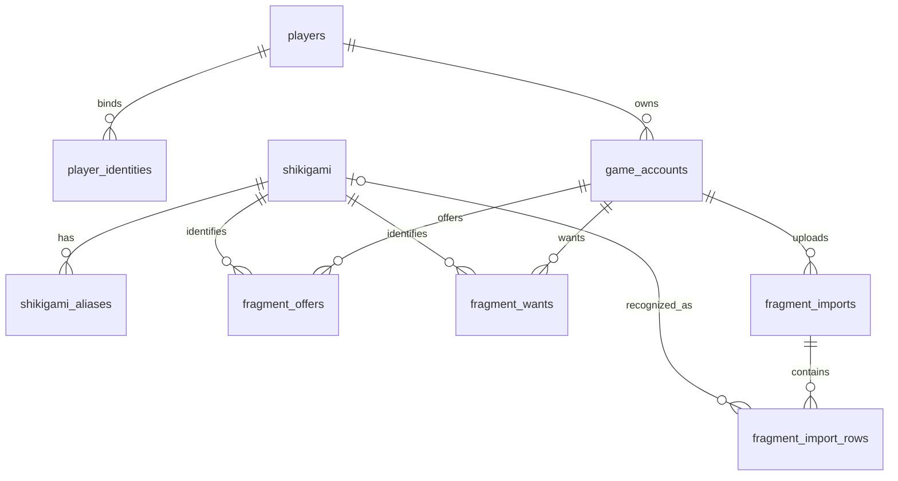

# 碎片交换的数据结构

一个新的 `onmyoji_shards` schema 已足够容纳当前资料及后续扩展，继续使用现有 Supabase PostgreSQL 数据库即可。抽奖继续使用 `lottery_app`，两者没有关联或共享表。

初始化文件是根目录的 `schema_shards.sql`。已按用户授权在当前 `.env` 对应的 Supabase 执行建表。网页式神图鉴现已连接真实数据库，可打开 `/shards#catalog` 查看；每次进入图鉴重新读取启用的式神和别名。不需要重复运行建表脚本。其他 Supabase 项目需要各自初始化。

用户将自行添加式神名字，未导入 Mock 图鉴或任何测试玩家、账号及库存。可在 Supabase 的 Table Editor 切换到 `onmyoji_shards`，打开 `shikigami` 新增：填写 `name` 和 `rarity`（`SSR`、`SP`、`UR` 或联动的 `COLLAB`），`image_path` 可稍后补充；`id`、创建时间、更新时间和启用状态有默认值。识别别名写到 `shikigami_aliases`，使用对应的正式式神 UUID。

执行后已确认：基础 9 张表全部启用 RLS，9 个更新时间触发器存在，`anon` / `authenticated` 均没有该 schema 的访问权限。网页由 Python 后端读取图鉴，不公开数据库凭据；真实图鉴为只读模式，禁止通过演示 Admin 写入。新增、修改请在 Supabase 操作。`image_path` 支持 HTTPS 图片网址，未填写时显示文字头像。上传识别使用真实图鉴配对；真实上传完成核对后可保存到所选游戏账号的确认清单，不会自动转成交换提供量或需求。测试显式提供临时目录时继续使用独立 Mock 图鉴。

## 表与关系

新增碎片工作台使用 `004_fragment_management.sql` 的 `fragment_current` 与 `portrait_samples`，已在当前数据库执行。当前数量由统一表维护，历史导入仍保留；Admin 可在网页写图鉴和审核头像，不再是初始原型的只读状态。详见 [碎片工作台](fragment-workspace.md)。

Discord 登录另外使用迁移 `migrations/003_discord_login.sql` 的 4 张私有认证表（已在当前数据库建立），连接原有玩家与 Discord 身份；详情见 [Discord 登录](discord-login.md)。不会将密码或一次性凭证存入式神表。

`shikigami.display_order` ??????????????????????? 133 ?????????????????? 1?133???? `display_order DESC NULLS LAST` ????????? `migrations/shikigami_display_order.tsv` ???? 1?144 ????????????????????????????????????????????????????????????? `instance/display-order-renumber-*.json`?

`shikigami.name` 保留原繁体名字，新增 `name_simplified` 保存用户提供的简体名字，允许为空（新增式神时可稍后补充）。现有对应表保存在 `migrations/shikigami_simplified_names.tsv`，字段迁移为 `migrations/001_shikigami_simplified_name.sql`。名称按用户提供的文字保存，不自动纠正或转换；此字段不会自动同步到识别别名或更改网页显示名字。

| 表 | 用途 |
| --- | --- |
| `shikigami` | 名字、头像路径、SSR / SP / UR / 联动分类、启用状态 |
| `shikigami_aliases` | 繁简体及人工认可的 OCR 别名 |
| `players` | 玩家显示名称、普通用户 / Admin 角色 |
| `player_identities` | 将 Discord、Web 或 Supabase 的验证身分绑定到同一玩家 |
| `game_accounts` | 游戏昵称、UID、地区、区服、平台、寮；一位玩家可有多个游戏账号 |
| `fragment_offers` | 每个游戏账号可提供的式神及碎片数量 |
| `fragment_wants` | 每个游戏账号想要的式神及碎片数量 |
| `fragment_imports` | 从 Web / Discord 上传长图的识别任务、来源、状态和图片路径 |
| `fragment_import_rows` | 每格 OCR 原文、候选对应式神、数量、分数、裁切范围及人工核对状态 |

这里的账号信息是游戏昵称、UID、区服等资料。玩家 ID、平台登录身分和游戏账号 ID 分开：玩家从 Discord 进入或从 Web 进入，都可以对应同一个人，其多个游戏账号的碎片不会混在一起。绑定平台身分时必须由后端验证，不能根据用户自行填写的 Discord ID、昵称或 Mock 切换器授予权限。

`player_identities.external_subject` 使用字符串保存平台 ID。后续若接 Supabase Auth，可将已验证的 Auth 用户 UUID 字符串绑定为 `provider='supabase'`，无需在此次初始脚本中依赖 `auth.users` 表。

## 数量与更新规则

- 提供清单和需求清单分开，使用 `(game_account_id, shikigami_id)` 作为各自的主键。同一个账号的同一个式神，每份清单只有一笔。
- 数量范围为 `0–99999`，与当前原型输入范围一致。`0` 表示当前没有可提供数量或已无需求；匹配时只查询正数。
- 图片里的数量用于更新当前可提供数量，不是每上传一次就把旧数加上去。是否替换图片中未出现的旧条目，仍需正式导入功能明确选择，不能默认将它们清零。
- 识别结果先进入 `fragment_imports` / `fragment_import_rows`。未识别到的式神或数量可为空，原始文字继续保留；只有对应式神与数量都明确、且未被排除的行才能标记为人工确认。
- 正式导入时，后端需要在同一数据库事务中检查所有保留行已确认、没有重复式神，然后更新 `fragment_offers`（或目标为 `wants` 时更新需求），并标记任务 `applied`。这些流程尚未接入 Web，SQL 外键与行级约束不能替代整份任务的业务校验。
- 式神资料被提供清单、需求或历史核对行引用后，不直接删除，改用 `is_active=false`。删除玩家或游戏账号会级联删除其清单和导入任务，因此正式后台应优先停用账号。

后续交换撮合、交换申请、履约记录、保留数量等，可以继续在同一个 schema 新增表；此次不提前实现交换事务或撮合规则。

## 图片与现有 Mock 的迁移

现有 `onmyoji` bucket 已按授权设为公开。已按分类和名字拼音，将 122 个实际存在且已验证可访问的图片网址填入 `shikigami.image_path`。没有改动式神名字或分类；未匹配的项目保持原样。

后续批量配图可使用 `sync_shikigami_images.py`（单独安装工具依赖 `pypinyin`，无需加入网站运行依赖）。先运行 `python sync_shikigami_images.py --project-url https://你的项目.supabase.co` 查看配对结果；加 `--apply` 才写入。私有 bucket 需要明确加 `--make-public` 才会公开整个 bucket。脚本按分类匹配唯一拼音，不做模糊猜测；写入前验证所有图片链接，并在忽略的 `instance/image-sync-*.json` 保存旧路径备份。匹配成功的记录会替换旧图片路径，未匹配记录不变。

图片实际文件放在后续确定的持久化对象存储，表中只记录 `image_path`。Render 本机头像路径和 `/api/shards/portraits/...` 是当前 Mock 的临时资源地址，不应当作正式永久头像地址直接迁移。

图鉴和玩家等主键采用 UUID。当前 Mock 中的 `seed-001` 等演示 ID 不能直接写入 UUID 字段；迁移时先按核对后的式神名字建立正式 UUID 映射，再导入别名、提供清单和需求。

## 执行与访问方式

决定正式建表后，可由数据库管理员在 Supabase SQL Editor 执行 `schema_shards.sql`。脚本带事务，只新增 `onmyoji_shards` 中的结构，不自动插入玩家、图鉴或测试资料。现有 `manage.py init-db` 仍只处理抽奖，不会执行此脚本。

脚本采用 `CREATE TABLE IF NOT EXISTS`，方便在初始安装时重跑；它不是后续升级迁移，未来增加字段需要新的 migration。重跑会重新设置该 schema 的更新时间触发器和权限。

此 schema 不需要加入 Supabase Data API 的 Exposed schemas。所有表启用 RLS，且默认移除 `anon` / `authenticated` / `PUBLIC` 的访问；不创建开放读写策略。未来 Web 和 Discord 通过 Python 后端、使用有相应权限的服务器数据库角色访问，并由后端检查玩家归属和 Admin 权限。当前数据库所有者连接可访问这些表；若改用专用连接角色，需另行按需要授权 schema、表和函数。

参考：[Supabase 自定义 schema](https://supabase.com/docs/guides/api/using-custom-schemas)、[RLS](https://supabase.com/docs/guides/database/postgres/row-level-security)、[PostgreSQL 约束](https://www.postgresql.org/docs/current/ddl-constraints.html)。
